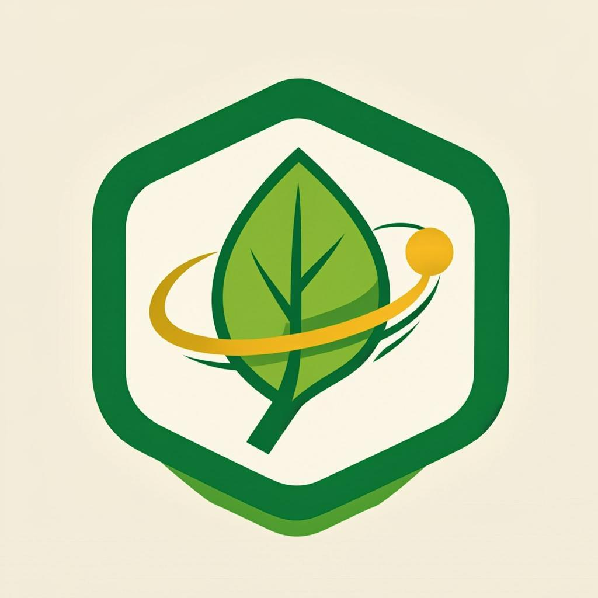

<div align="center">



# EarthSync · Field Shift

**Satellite data made understandable for everyday farming decisions**

A NASA Space Apps Challenge 2026 project by **Team Cosmic Chaos**

[**Try the web app**](https://earth-sync-rose.vercel.app/) · [**Demo walkthrough**](docs/ux/SUBMISSION_HANDOFF.md) · [**Local setup**](docs/release/FINAL_LOCAL.md)

</div>

---

## 🌱 Welcome to EarthSync

Farmers need to make decisions while weather, soil moisture, and seasonal conditions change. EarthSync brings together environmental observations, crop references, and farmer-entered field information in a simpler interface.

Think of it as **a field notebook with a window into Earth observations**: it shows dated evidence, helps compare crop-rotation ideas, and lets farmers document decisions. It does **not** replace farmers, soil laboratories, or qualified agricultural advice.

> ### ⚠️ APK demo vs. real-time implementation
>
> **The shared Android APK uses simulated/demo data. It is not a real-time data application.** Treat its screens and sample values as a demonstration of the user experience, not as current measurements, live warnings, or validated crop recommendations.
>
> **The repository also includes a real-time-ready implementation**—data-provider integrations, backend services, source timestamps, and local launch/test scripts. Live retrieval depends on running and configuring those services, third-party availability, permissions, and successful validation. **Real-time-ready does not mean the APK receives live data or that the hosted web app exposes the complete local backend.**
>
> The [local real-time guide](docs/realtime/README.md), [verification notes](docs/realtime/VERIFICATION.md), and [final local startup](docs/release/FINAL_LOCAL.md) explain the implementation and its limits.

## ✨ What can you explore?

| Feature | Purpose |
| --- | --- |
| **Farm map & field context** | Choose a field and distinguish mapped/model data from information reported by a farmer. |
| **Weather & climate evidence** | Inspect dated rainfall, temperature, forecast and other available environmental context. |
| **Soil information** | View modeled soil properties with source and resolution caveats; these are not laboratory measurements. |
| **Crop information & rotation comparison** | Explore source-backed crop references and compare a farmer-declared rotation with alternatives. |
| **Vegetation (NDVI) views** | Examine satellite vegetation information where imagery access, quality checks and coverage allow it. |
| **Farmer tools** | Keep tasks, notes, observations, photos and saved decisions in supported local workflows. |
| **Accessible assistant** | Explore evidence using simpler language, citations and stated uncertainty; some scientific material remains in English. |

**No guaranteed recommendations:** The project's 60 candidate crop-suitability rules remain blocked pending scientific review. EarthSync does not identify an approved “best crop,” predict farm income, or prescribe irrigation from satellite data alone.

## 🛰️ Data and scientific context

| Source / method | Used for |
| --- | --- |
| **NASA POWER** | Historical weather and climate inputs |
| **NASA HLS vegetation products** | Quality-screened NDVI satellite imagery, when available |
| **ISRIC SoilGrids** | Modeled soil-property context |
| **Weather observations and forecast services** | Dated conditions, model projections and regional context |
| **FAO-56 Penman–Monteith** | Reference evapotranspiration (ET₀), not crop irrigation demand |
| **Crop references and farmer observations** | Crop facts, rotation histories, local priorities and reported field details |

Each product has its own scale and update schedule. A regional soil estimate or model forecast is **not** the same as an on-farm measurement. See [source provenance](docs/release/PROVENANCE.md) and [capability coverage](docs/release/COVERAGE.md).

## 🛠️ Technology

| Component | Technology |
| --- | --- |
| User interface | Flutter / Dart |
| API and integration | Python / FastAPI |
| Scientific and evidence processing | Rust |
| Local structured data | SQLite |
| Farm maps | Map layers and OpenStreetMap-based context |

Simplified flow:

```text
NASA / weather / soil / crop sources + farmer input
                       ↓
           Backend and Rust processing
                       ↓
          Dated evidence + local records
                       ↓
             Flutter app interface
                       ↓
           Explore • Compare • Save
```

Some workflows run locally without sign-in. Fresh external observations require connectivity and properly configured providers; cached evidence keeps its original dates.

## 🚀 Run locally

Use the local launcher to evaluate the **full-stack implementation**, not the simulated-data APK.

**Requirements:** Python 3.12+, Rust/native toolchain (reviewed with Rust 1.99.0), Flutter 3.44.0 / Dart 3.12.0, and build tools for your platform. Some NASA services require optional Earthdata authorization.

```bash
git clone https://github.com/SkyRR23/EarthSync.git
cd EarthSync
```

**Windows (PowerShell):**

```powershell
.\start-earthsync.ps1
```

**Linux / macOS:**

```bash
./start-earthsync.sh
```

Wait for the launcher's readiness checks and open **the browser URL printed by the launcher**. It may use a different local port on different machines.

| Action | Windows | Linux / macOS |
| --- | --- | --- |
| Smoke test | `.\test-earthsync.ps1` | `./test-earthsync.sh` |
| Stop services | `.\stop-earthsync.ps1` | `./stop-earthsync.sh` |

The scripts build and run local services; they do not deploy the backend to the public website. Private databases, photos, credentials and local runtime state should not be committed.

For prerequisites, logs, testing, missing-source behavior, and known limitations, see [FINAL_LOCAL.md](docs/release/FINAL_LOCAL.md).

## 🎬 Demo and deployment notes

- **Android APK:** simulated/demo data; **not** a live-data feed.
- **Public web app:** [earth-sync-rose.vercel.app](https://earth-sync-rose.vercel.app/). Feature and backend availability at this public URL must be checked independently; the link alone is not proof of live NASA integration.
- **Full local stack:** use the launcher above for the backend and available real-time provider integrations. Sources may be delayed, missing, unauthorized or unavailable.
- **Satellite imagery and AI:** vegetation access is conditional; ordinary field photos do not automatically measure soil chemistry. Optional vision functionality requires separate configuration and consent.

Use the [five-minute judging walkthrough](docs/ux/SUBMISSION_HANDOFF.md) to demonstrate the farmer journey. Be clear when a screenshot is illustrative rather than a real observation.

## 📚 Documentation

- [Final local setup and demonstration](docs/release/FINAL_LOCAL.md)
- [Farmer experience and submission handoff](docs/ux/SUBMISSION_HANDOFF.md)
- [Real-time integration and sources](docs/realtime/README.md)
- [Real-time verification and unresolved gates](docs/realtime/VERIFICATION.md)
- [Feature coverage and scientific limitations](docs/release/COVERAGE.md)
- [Data provenance, privacy and licensing](docs/release/PROVENANCE.md)
- [Release and hosting limitations](docs/release/HOSTING.md)

## 🤝 Team

**Cosmic Chaos** — Hein Lin, Yan Nan Aung, Htoo Htoo Aung and Amara Cho.

Built for the NASA Space Apps Challenge 2026. Thanks to the public Earth-observation, agricultural and open-source communities whose datasets and tools help make this work possible.

---

<div align="center">

**EarthSync — turning complex Earth data into understandable field context.**

</div>
