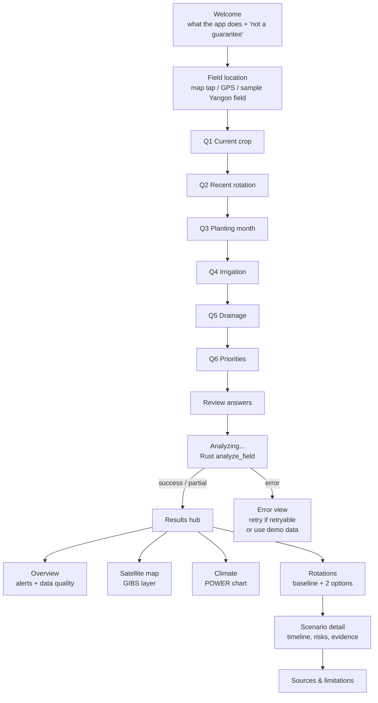
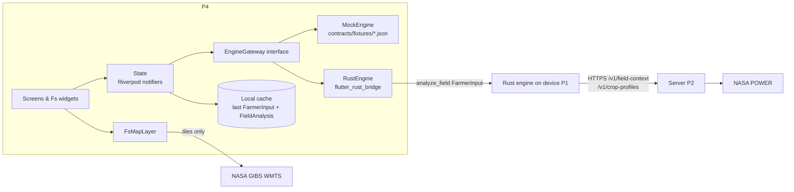
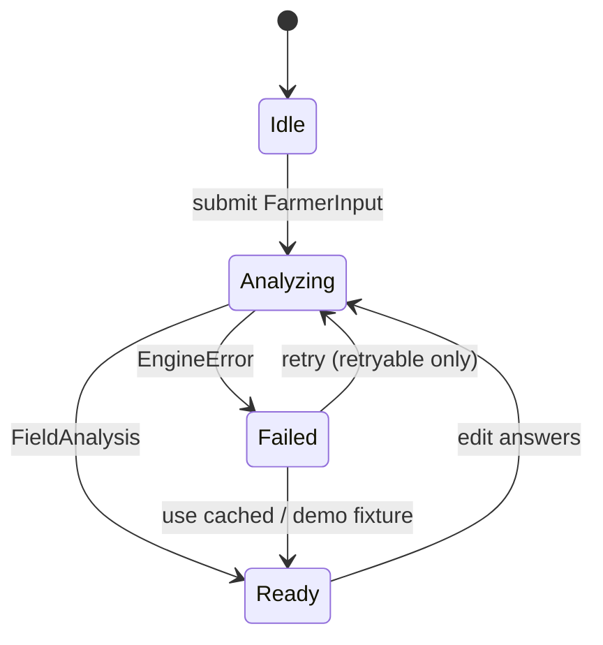

# Field Shift — Flutter Design System, Workflow & Data Flow

Owner: P4 (Flutter). Reviewers: P1 (bridge/contract), P3 (wording, mockups).
Status: v0.1 draft for hour H0–H2. Contract names follow master plan v3 §07 and must be re-checked against the frozen `contracts/` schema v1.

---

## 1. Design principles

| Principle | What it means in this app |
|---|---|
| **Readable outdoors** | High contrast, large text, no light-grey-on-white. Farmers use phones in sunlight. |
| **One question per screen** | Inputs are a stepper, never a long form. Every question has an **"I don't know"** answer. |
| **Never colour alone** | Every status (supported / constrained / unknown, risk levels) has an icon + word + colour. |
| **Show the evidence** | Every claim links to a source, date range and spatial scale. Unknown is shown as unknown, never as "low risk". |
| **Plain English** | English-only UI for the MVP. Short, everyday words ("rain", "wet soil"), no jargon. All strings kept in one file (`lib/app/strings.dart`) so wording is easy for P3 to review. |
| **No false precision** | No yield %, no "success probability". Components have no slot for such numbers. |

---

## 2. Design tokens

All tokens live in `lib/design/tokens.dart` and are consumed through `ThemeData` + a `FsTokens` `ThemeExtension`. **No hardcoded colours, sizes or paddings in widgets.**

### 2.1 Colour

Brand

| Token | Hex | Use |
|---|---|---|
| `brand.primary` | `#2E7D32` | Primary buttons, selected state, app bar |
| `brand.onPrimary` | `#FFFFFF` | Text/icons on primary |
| `brand.primaryContainer` | `#C8E6C9` | Selected chips, highlights |
| `brand.earth` | `#6D4C41` | Soil / field accents, secondary actions |
| `brand.sky` | `#1565C0` | Rainfall, water, irrigation |

Neutral

| Token | Hex | Use |
|---|---|---|
| `neutral.bg` | `#FAFAF7` | Screen background |
| `neutral.surface` | `#FFFFFF` | Cards |
| `neutral.border` | `#D6D6CF` | Card and input borders |
| `neutral.textPrimary` | `#1B1B18` | Body text (contrast ≥ 15:1 on bg) |
| `neutral.textSecondary` | `#4A4A44` | Captions (contrast ≥ 7:1, not lighter) |

Semantic — **feasibility** (from the Rust engine, plan §08)

| Token | Hex | Icon | Label |
|---|---|---|---|
| `feasibility.supported` | `#2E7D32` | `check_circle` | Supported |
| `feasibility.constrained` | `#B26A00` | `warning_amber` | Constrained |
| `feasibility.unknown` | `#5F6368` | `help_outline` | Unknown |

Semantic — **risk / alerts** (drought, heat, waterlogging)

| Token | Hex | Use |
|---|---|---|
| `risk.high` | `#C62828` | High risk badge, alert card stripe |
| `risk.medium` | `#B26A00` | Medium |
| `risk.low` | `#2E7D32` | Low |
| `risk.unknown` | `#5F6368` | No data — always paired with "not enough data" text |

Semantic — **evidence type** (plan §16 requires these to be visibly distinct)

| Token | Hex | Icon | Meaning |
|---|---|---|---|
| `evidence.observation` | `#1565C0` | `satellite_alt` | NASA gridded observation (POWER, IMERG) |
| `evidence.model` | `#6A1B9A` | `model_training` | Modelled estimate (SoilGrids, SMAP L4) |
| `evidence.imagery` | `#00838F` | `image` | Map imagery (GIBS) — visual only, not numeric evidence |
| `evidence.reference` | `#6D4C41` | `menu_book` | Curated crop fact (FAO, IRRI) |
| `evidence.unverified` | `#5F6368` | `report` | Parameter with no verified source |

Dark mode is out of MVP scope (sunlight use); keep tokens structured so it can be added.

### 2.2 Typography

Font: **Noto Sans**, bundled in `assets/fonts/` (OFL, add to `docs/licenses/`).

| Token | Size / weight | Line height | Use |
|---|---|---|---|
| `type.display` | 28 / 700 | 1.4 | Screen question ("What do you grow now?") |
| `type.title` | 22 / 600 | 1.5 | Card titles, scenario names |
| `type.body` | 18 / 400 | 1.6 | Default body — **18, not 14** |
| `type.label` | 16 / 600 | 1.5 | Buttons, chips, badges |
| `type.caption` | 14 / 400 | 1.5 | Source lines, dates, units |

Respect the system text scale; test at 1.3×.

### 2.3 Spacing, size, shape, motion

| Group | Tokens |
|---|---|
| Spacing (4-pt) | `space.xs 4` · `sm 8` · `md 16` · `lg 24` · `xl 32` · `xxl 48` |
| Screen gutter | 16 horizontal |
| Touch target | **min 56 × 56** (above Material's 48 for rough-handed / outdoor use) |
| Primary button height | 56, full width |
| Radius | `radius.sm 8` (chips) · `md 12` (inputs, buttons) · `lg 16` (cards) |
| Border | 1 default · 2 selected / focused |
| Elevation | `0` flat cards with border; `2` only for bottom sheets / floating map controls |
| Motion | `fast 150ms`, `normal 250ms`, curve `easeOutCubic`; disable when `MediaQuery.disableAnimations` |

### 2.4 Token code (starter)

```dart
// lib/design/tokens.dart
import 'package:flutter/material.dart';

abstract final class FsColors {
  static const primary = Color(0xFF2E7D32);
  static const primaryContainer = Color(0xFFC8E6C9);
  static const earth = Color(0xFF6D4C41);
  static const sky = Color(0xFF1565C0);
  static const bg = Color(0xFFFAFAF7);
  static const surface = Color(0xFFFFFFFF);
  static const border = Color(0xFFD6D6CF);
  static const textPrimary = Color(0xFF1B1B18);
  static const textSecondary = Color(0xFF4A4A44);

  static const supported = Color(0xFF2E7D32);
  static const constrained = Color(0xFFB26A00);
  static const unknown = Color(0xFF5F6368);
  static const riskHigh = Color(0xFFC62828);
}

abstract final class FsSpace {
  static const xs = 4.0, sm = 8.0, md = 16.0, lg = 24.0, xl = 32.0, xxl = 48.0;
  static const gutter = 16.0;
  static const minTouch = 56.0;
}

abstract final class FsRadius {
  static const sm = Radius.circular(8);
  static const md = Radius.circular(12);
  static const lg = Radius.circular(16);
}

ThemeData fsTheme() {
  const scheme = ColorScheme.light(
    primary: FsColors.primary,
    primaryContainer: FsColors.primaryContainer,
    secondary: FsColors.earth,
    surface: FsColors.surface,
    onSurface: FsColors.textPrimary,
    error: FsColors.riskHigh,
  );
  return ThemeData(
    colorScheme: scheme,
    scaffoldBackgroundColor: FsColors.bg,
    fontFamily: 'NotoSans',
    textTheme: const TextTheme(
      headlineMedium: TextStyle(fontSize: 28, fontWeight: FontWeight.w700, height: 1.4),
      titleLarge: TextStyle(fontSize: 22, fontWeight: FontWeight.w600, height: 1.5),
      bodyLarge: TextStyle(fontSize: 18, height: 1.6),
      labelLarge: TextStyle(fontSize: 16, fontWeight: FontWeight.w600, height: 1.5),
      bodySmall: TextStyle(fontSize: 14, height: 1.5),
    ).apply(bodyColor: FsColors.textPrimary, displayColor: FsColors.textPrimary),
    filledButtonTheme: FilledButtonThemeData(
      style: FilledButton.styleFrom(
        minimumSize: const Size.fromHeight(FsSpace.minTouch),
        shape: const RoundedRectangleBorder(borderRadius: BorderRadius.all(FsRadius.md)),
      ),
    ),
    cardTheme: const CardThemeData(
      elevation: 0,
      color: FsColors.surface,
      shape: RoundedRectangleBorder(
        borderRadius: BorderRadius.all(FsRadius.lg),
        side: BorderSide(color: FsColors.border),
      ),
    ),
  );
}
```

---

## 3. Components

All components are prefixed `Fs` and live in `lib/design/components/`. Each must handle the states listed; a component without a loading / unknown state is not done.

| Component | Purpose | Variants | Required states |
|---|---|---|---|
| `FsButton` | Main actions | `primary` (filled), `secondary` (outlined), `text` | default, pressed, disabled, loading (spinner + keeps label width) |
| `FsChoiceGroup<T>` | One question's answers as big tappable tiles with icon | `single`, `multi` (priorities) | unselected, selected (2px primary border + check), disabled; **always includes "I don't know"** |
| `FsStepScaffold` | Wraps each questionnaire step | — | progress "2 of 6", back, next disabled until answered |
| `FsLocationPicker` | Pick field on map or use sample Yangon field | `map`, `sample` | no permission, locating, picked, out-of-Myanmar warning |
| `FsFeasibilityBadge` | supported / constrained / unknown | `compact`, `full` | — (all three always icon + text) |
| `FsRiskBadge` | drought / heat / waterlogging level | per hazard | high, medium, low, **unknown** |
| `FsEvidenceChip` | Source pill: type icon + short name + date range | by evidence type | tap → opens `FsSourceSheet` |
| `FsSourceSheet` | Bottom sheet with source, period, grid resolution, "regional estimate" note | — | — |
| `FsScenarioCard` | One rotation strategy | `baseline` (labelled "Your current practice"), `alternative` | collapsed, expanded, has-gaps (shows data gap banner inside) |
| `FsRotationTimeline` | 12-month strip showing crop windows per step | — | conflicting window (striped red), unknown window (dashed grey) |
| `FsClimateChart` | NASA POWER monthly rainfall bars + temp line | `rain`, `temp`, `combined` | loading skeleton, missing months (gap + "no data" marker, never zero) |
| `FsMapLayer` | `flutter_map` + GIBS tile layer + legend + date + attribution | — | tiles loading, tile error ("satellite image unavailable"), offline |
| `FsAlertCard` | Weather/climate alert from analysis | by risk level | dismissible = no (alerts stay visible) |
| `FsDataQualityBanner` | Top-of-results notice: stale / partial / demo-fixture data | `info`, `warning` | shows `fetched_at` |
| `FsStateView` | Full-screen loading / error / empty | `loading`, `error`, `offline`, `empty` | error shows retry only if `retryable` |

### Key component specs

**FsScenarioCard**

| Property | Type | Description |
|---|---|---|
| `scenario` | `RotationScenario` | From `FieldAnalysis.scenarios` |
| `isBaseline` | `bool` | Baseline gets "Your current practice" label and neutral border |
| `evidence` | `List<Reference>` | Resolved from `evidence_ids` |
| `onOpenDetail` | `VoidCallback` | Opens scenario detail |

Layout (top → bottom): title + feasibility badge → `FsRotationTimeline` → "Possible benefits" (✓ list) → "Risks" (risk badges) → "Limitations" → evidence chips. **No yield number anywhere.**

**FsChoiceGroup — do / don't**

| ✅ Do | ❌ Don't |
|---|---|
| Icon + short word per option ("Rice", "Mung bean") | Dropdowns |
| "I don't know" as the last option, same size as others | Hide "unknown" behind a link |
| Remember answer when user goes back | Validate with red errors — just disable Next |

### Accessibility checklist (every component)
- `Semantics` label on every badge, icon and chart; badges read as "Status: constrained".
- Min touch 56dp; focus order top → bottom.
- Contrast ≥ 4.5:1 for text, ≥ 3:1 for icons/borders.
- Charts expose a text summary ("Rain in June: 410 mm") via `Semantics`.

---

## 4. Workflow (farmer journey)



Screens (MVP = 8): Welcome, Location, Questionnaire (6 steps, one widget), Review, Analyzing, Results hub (4 tabs), Scenario detail, Sources.

Navigation: `go_router`. Results hub uses a bottom `NavigationBar` with 4 tabs (icon + label). Back from Results returns to Review, keeping answers.

---

## 5. Data flow

### 5.1 Layers



Rules:
1. **Flutter never calls the server or NASA POWER.** Only Rust does (plan §05).
2. **Flutter calls GIBS only for map tiles**, never for numbers.
3. Widgets never touch the gateway; they read state from notifiers.
4. `MockEngine` and `RustEngine` implement the same interface, chosen at startup (`--dart-define=ENGINE=mock|rust`). UI work never waits for the bridge.

### 5.2 Dart models (mirror contract v1)

```dart
// lib/data/models/ — generated by flutter_rust_bridge for RustEngine,
// hand-written json for MockEngine until then. Names follow plan §07.
class FarmerInput {
  final double latitude, longitude;
  final String? currentCrop;        // null = unknown
  final List<String> recentRotation;
  final int? plantingMonth;         // 1–12, null = unknown
  final Irrigation irrigation;      // none | partial | full | unknown
  final Drainage drainage;          // poor | moderate | good | unknown
  final List<Priority> priorities;
}

class FieldAnalysis {
  final Location location;
  final ClimateSummary climateSummary; // monthly rain/temp + units + period + source
  final List<RotationScenario> scenarios; // [0] = baseline, ≥ 3 total
  final List<Alert> alerts;
  final List<String> assumptions;
  final List<DataGap> dataGaps;
  final List<Reference> references;
}

class RotationScenario {
  final String id, title;
  final List<RotationStep> steps;       // crop + month window
  final Feasibility eligibility;        // supported | constrained | unknown
  final List<String> likelyBenefits, risks, limitations;
  final List<String> evidenceIds;
}

class EngineError {
  final String code, message;
  final bool retryable;
  final List<String> missingSources;
}
```

### 5.3 Gateway and state

```dart
abstract interface class EngineGateway {
  Future<FieldAnalysis> analyzeField(FarmerInput input); // throws EngineError
  Future<String> engineVersion();                        // H2 bridge smoke test
}

sealed class AnalysisState {}
class Idle extends AnalysisState {}
class Analyzing extends AnalysisState {}
class Ready extends AnalysisState {          // success or partial
  final FieldAnalysis analysis;
  final bool fromCache;                       // show FsDataQualityBanner
  Ready(this.analysis, {this.fromCache = false});
}
class Failed extends AnalysisState {
  final EngineError error;
  final FieldAnalysis? cached;                // offer "show last result"
  Failed(this.error, {this.cached});
}
```

State transitions:



How states map to UI:

| Data situation | UI |
|---|---|
| Analyzing | `FsStateView.loading` with "Reading NASA data for your field…" |
| `dataGaps` not empty | `FsDataQualityBanner.warning` + affected cards show "Unknown" badges |
| Risk value missing | `FsRiskBadge.unknown` — **never** shown as low |
| Month missing in climate | Gap in chart + "no data", never a zero bar |
| `fromCache` / demo fixture | Banner: "Saved data from {fetched_at}" / "Demo data" |
| `EngineError.retryable` | Error view with Retry; else "Use demo field" |

### 5.4 Satellite map

- `flutter_map` `TileLayer` with the GIBS WMTS REST template (layer ID, date and tile matrix set **supplied by P2**, not invented):
  `https://gibs.earthdata.nasa.gov/wmts/epsg3857/best/{layer}/default/{date}/{tileMatrixSet}/{z}/{y}/{x}.{ext}`
- Legend, date label and "Imagery: NASA GIBS / {layer}" attribution always visible.
- Map imagery is tagged `evidence.imagery` and is never used as numeric evidence in cards.

---

## 6. Project structure (`app/lib/`)

```
lib/
  main.dart                    # picks MockEngine / RustEngine, ProviderScope
  app/router.dart              # go_router routes
  app/strings.dart             # all English UI text in one place
  design/
    tokens.dart  theme.dart
    components/                # Fs* widgets
  data/
    models/                    # FarmerInput, FieldAnalysis …
    engine/  engine_gateway.dart  mock_engine.dart  rust_engine.dart
    cache/   analysis_cache.dart
  features/
    onboarding/  location/  questionnaire/  analysis/
    results/  overview/ map/ climate/ rotations/
    sources/
  src/rust/                    # flutter_rust_bridge generated (do not edit)
```

Packages: `flutter_riverpod`, `go_router`, `flutter_map` + `latlong2`, `fl_chart`, `intl` (dates/numbers), `shared_preferences`, `flutter_rust_bridge`.

---

## 7. Build workflow for P4 (matches plan §12 gates)

| Hours | Flutter work | Gate |
|---|---|---|
| H0–H2 | Theme + tokens, router, empty screens, `engineVersion()` call through bridge on Android | **Rust call succeeds on device** |
| H2–H8 | Questionnaire + location picker against `MockEngine`; first GIBS tile layer | Real NASA tile visible |
| H8–H14 | Results hub, `FsScenarioCard`, `FsClimateChart` from fixtures | 3 scenarios render from fixture |
| H14–H22 | Swap to `RustEngine`; loading / error / partial states; cache | End-to-end live analysis |
| H22–H28 | Wording pass with P3, a11y check, APK on 2+ devices | Freeze |
| H28–H33 | Release APK, screenshots, offline demo fixture | Submission |

Team workflow:
- Work on branch `feature/flutter-app`, only inside `app/`.
- Contract changes → PR touching `contracts/`, reviewed by P1 + P2.
- P3 owns wording: P3 reviews `strings.dart` for plain, farmer-friendly English.
- Before each PR: `flutter analyze`, `flutter test`, golden test of `FsScenarioCard` at 1.0× and 1.3× text scale.

---

## 8. Open questions

- Exact GIBS layer ID and date (P2) — IMERG rainfall vs. MODIS true colour.
- Are `priorities` a fixed enum? Need list from P2/P3.
- Does Rust return display text, or keys that Flutter maps to text? **Recommend keys** (e.g. `risk.waterlogging.poor_drainage`) so all wording stays in `strings.dart` and P3 can edit it without touching Rust.
- Township selector (geoBoundaries) vs. map tap only for MVP.
