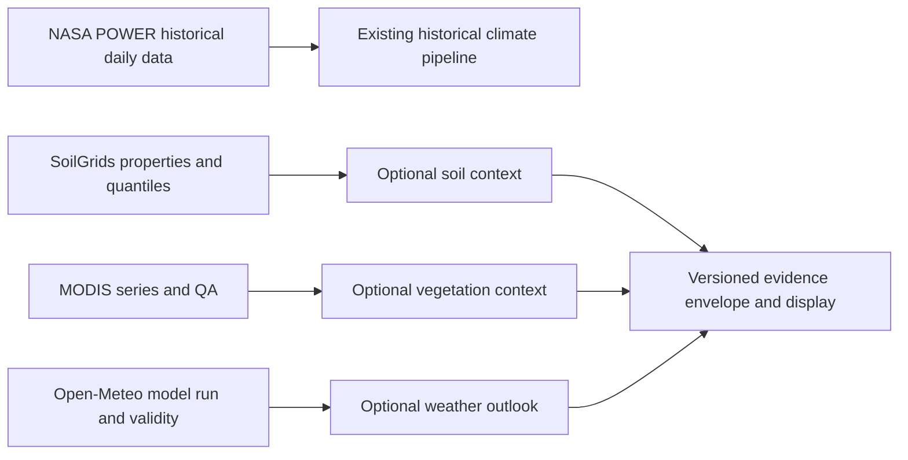

# Optional adapter proposal

Proposal only. No server routes, Rust types, Flutter components, data collectors
or agricultural suitability rules are implemented by this milestone. The three
research fixtures exercise normalization/missingness; they are not accepted
production payloads and must not be fed directly to `SeasonalRequest`.

## Boundary and common evidence envelope

Keep each source independently optional, with separate caches and error states.
The verified POWER historical climate request/response and its normalization
remain authoritative for that pipeline. Failure of an optional source must
produce an explicit unavailable context, without a climate fallback or inferred
soil/crop attribute. No cross-source average or silently shared completeness flag.

Proposed additive envelope, to agree with owners before implementation:

| Field | Requirement |
| --- | --- |
| `schema_version`, `context_kind` | Version independent of current Rust/POWER contract; soil, vegetation or outlook |
| `query_location` | Field ID and requested WGS84 point/geometry; separate native grid centre/footprint and extraction method |
| `data_type` | `observed`, `modeled`, `forecast`, `hypothetical`, `farmer_reported`, `unavailable`; do not coerce unsupported enums into current Rust types |
| `source` | Provider, dataset/product, collection/version, variable/band, model/statistic, DOI/docs, license and attribution |
| `retrieval` | Sanitized exact endpoint/query, UTC retrieval timestamp, response/header metadata, original response hash, immutable raw reference; retries/errors retained |
| `temporal_support` | Measurement/composite/local-day interval or static model support; time standard/timezone; forecast issue/run and validity separately |
| `spatial_support` | Native resolution, CRS, grid-cell footprint or explicit unknown, query/extraction support; no precision derived from decimal coordinates |
| `values` | Original value/unit and normalized value/unit, declared fill/range checks, transformation ID and documented scale/offset |
| `quality` | Per-variable/per-period presence, QA bits and policy/version, expected/valid counts, missing dates and reasons; unknown is not good quality |
| `uncertainty` | Provider quantiles/categories only with definitions; explicit null/status if absent, never invented confidence |
| `usability`, `limitations` | Ready/reference-only/unavailable reason; context scope and no agricultural inference |

Transport failure, unverified metadata, a quality-rejected value, an absent
record and an expired forecast must be distinct states. A present number may
still be unusable. Keep `data_type` and quality separate: a cloudy satellite
retrieval does not become a model estimate. A missing value is unavailable and
can retain its expected source type at the series level.

## A. Soil context — suggested first addition after metadata recovery

Input: versioned ISRIC SoilGrids native properties and statistics. Preserve
mean/median identity and explicit depth boundaries, rather than averaging depths
or presenting a single universal soil number. Keep Q05/Q50/Q95 in original and
converted units when available; absence is null. A mean is not interchangeable
with a median, and a 90% prediction interval is not a laboratory error bar.

Use documented WCS/WebDAV/native data access or a validated WMS point extraction;
record actual native cell support, display/query resolution, resampling and
release. Pin layer/property units and reject drift instead of trusting hardcoded
labels. Cache by release, property, depth, statistic and native cell/extraction
identity, preserving requested field association. Refresh by source revision,
not as though these were daily observations. Unit transformations are in the
source manifest; retain originals beside the converted values.

Research fixtures: all three points, 32 rows each, four depths. Conversions are
validated. Unknown release/quantiles/source body binding and cell extraction
remain explicit. Suggested release gate: recover raw metadata and source linkage,
verify spatial sampling and version, fetch uncertainty where available or document
its absence with the context's owner, and approve the limited display wording.
This gate does not require inventing unavailable uncertainty.

Display as modeled regional soil context. Do not set the farmer's texture or
drainage inputs automatically. No new categorical texture/drainage rule, Ksat
substitution, fertility assessment, nutrient recommendation or crop suitability
is part of this adapter. Farmer-reported values, if collected later, retain
their own provenance, date and `farmer_reported` type alongside estimates.

Useful future tests: wrong units/statistic/depth rejected; quantile order and
units retained; missing quantiles stay unknown; coordinate/cell mismatch visible;
no layer response becomes unavailable; known clay/pH/N/bulk-density arithmetic;
no automatic drainage or cross-depth fill.

## B. Historical vegetation context — QA required before analysis

Input: exact MOD13Q1 NDVI/EVI and MOD11A2 day/night LST collections, original
subset metadata and matching QA. Query date availability per location/product;
chunk by at most ten returned composite dates per ORNL documentation. Preserve
failed chunks and missing periods, not just concatenated successes. Keep product
versions and pixel footprints homogeneous within a series; reject duplicate
conflicting periods, scale changes and mixed locations.

Check fill and valid range in original storage units before scaling. Retain raw
codes for rejected samples and the exact reason/QA. MOD13 VI Quality and pixel
reliability should retain cloud/shadow/snow/aerosol/usefulness information.
MOD11A2 needs QC_Day/QC_Night and clear-sky/view metadata where available.
Any acceptance mask must be provider-documented, explicit and versioned; do not
invent a farm-confidence percentage. Missing QA is unknown, not pass. Do not
blanket-mask every upper-range code, or use zero QC as missing.

Store exact composite bounds, nominal cadence and observation support separately:
the final annual composite may be shorter, and valid daily sample counts can be
less than its nominal duration. Maintain per-index/day-night missingness and
quality; no interpolation. Cache by collection, band, native pixel, interval and
quality-policy version. Source revisions create new retained captures.

Research fixtures: six NDVI/EVI series of 46 starts, six LST series of 92 starts.
Numeric conversions and calendar coverage are checked; all QA remains null,
and every numeric record is explicitly ineligible for scientific analysis.
Release gate: recover subset collection, actual pixel support, source response
chain and QA; assess the provider-defined quality policy. A later historical
context display must show gaps and a satellite-derived label.

Do not create disease detection, current anomalies or causal stress messages.
Those would require comparable current data, QA-screened and validated baselines,
appropriate seasonal/crop/land-cover context and a separate validation study.
Two historical years and an illustrative formula do not provide that evidence.
LST never substitutes for historical T2M air temperature.

Useful future tests: raw fill before Celsius conversion; NDVI negatives retained
when valid; zero QC handled correctly; per-variable quality rejection; absent
composites distinct from present-but-empty composites; truncated final period;
collection/scale/pixel mismatch rejected; no anomaly result when baseline or
current sample is unavailable.

## C. Weather outlook — capture identity and freshness first

Input: Open-Meteo forecast with explicit requested model(s) where possible.
Preserve `daily_units`, requested and returned coordinates, elevation/grid
selection, timezone/UTC offset, raw response, UTC retrieval and model/provider
identity. Best Match is a selection policy, not a named weather model. If a
seamless series changes models, retain that source identity at the applicable
variable/time level. Do not label default output ERA5-Land or a single IFS run.

Record forecast issue/model-initialization time only when actually supplied by
the provider/run metadata. `generationtime_ms` is processing duration and cannot
serve as issue time. If the generic endpoint cannot supply a trustworthy run
identity, evaluate the documented single-run/model-update mechanism; otherwise
return issue-time-unavailable and withhold live use under the proposed strict
contract. Current conditions are modeled; forecasts retain `forecast` even after
their target date passes. Elapsed forecasts do not become observations.

Freshness policy must be explicit configuration tied to the selected model's
documented update cadence and the application's accepted maximum age; this audit
does not invent a TTL. Proposed evaluation at UTC `as_of`:

1. Validate source/run, retrieval timestamp, time ordering, units and location.
   Unknown required metadata returns unavailable, not a fresh default.
2. Compute each sample's validity interval using the retained timezone/offset
   and variable semantics. Check whether the requested target lies within it.
3. With a configured approved age limit, set cache expiry no later than the end
   of the applicable validity horizon and the permitted retrieval age. Retain
   the policy ID and computed expiry. If required inputs are unknown, expiry
   stays unknown and live usability fails closed.
4. At/after expiry, refetch into a new capture. An old capture may remain in a
   visibly dated historical view but cannot satisfy a live request. A refresh
   failure returns unavailable outlook and keeps the stable climate result.

Cache key includes location/grid selection, model/run, requested variables and
units, timezone and validity interval. Local-date validity is not a UTC midnight
assumption. Daily precipitation accumulation, probability, ET0 and soil-layer
means retain their different semantics. Zero precipitation is present data;
two missing soil-tail days must not be filled with zero, carried forward or
declared complete because temperature exists.

Research fixtures: 16 local dates per point, with missing issue/retrieval/expiry,
timezone, resolved-model and original-response-unit evidence explicitly marked.
They reproduce archived values and unknown states only. Release gate: make a
new, independently captured and reviewed forecast response with all required
metadata and license/access attribution. Never overwrite the contributed capture
or copy its snapshots into POWER history.

Useful future tests: missing issue/retrieval rejected for live use; expiration at
the exact boundary using a fixed test clock; Myanmar half-hour offset/local-day
bounds; model revision/cache separation; original-unit drift; partial-variable
coverage; refresh failure without historical-climate substitution; archive replay
never shown as current.

## Staged implementation and stop point

1. Accept the research inventory and unresolved limitations; keep raw immutable.
2. Agree one additive evidence contract and limited source display per adapter.
3. Resolve soil provenance/spatial metadata first; then historical MODIS QA;
   then separately capture a fully timed forecast. Each can remain unavailable
   independently. No requirement to implement all APIs together.
4. Implement adapters in a future explicitly scoped change, with the fixture
   cases above and new provider captures where needed. Agree any Rust/Flutter
   mapping with their owners; the current enums/envelopes are not silently extended.

This milestone stops at preservation, audit, fixtures, tests and proposal. It
does not approve new crop rules, replace the missing crop catalog, alter the
live NASA integration or merge/deploy anything.
