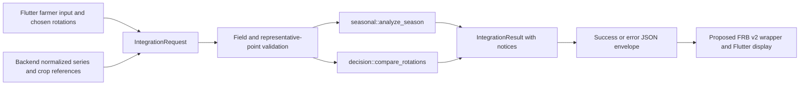

# Engine integration readiness — Milestone 3B (PROPOSED)

## Repository evidence and architecture

Started from `1f939a472943a5199971a71b8c46cbe4feab6239` on
`feat/crop-rotation-foundation`. Inspected all existing Rust modules and engine
contracts and the unapproved PR #2 contract at
`docs/team-contract-v1:b30cae1ef20c6ed35969046f2fa6bc59ab6008e8`.
Remote heads and available remote branch trees were checked on 14 November 2026:
only the documentation, Rust feature and main branches were advertised. None had
`app/`, `server/`, `pubspec.yaml` or `flutter_rust_bridge.yaml`. No teammate files
were changed, merged or copied. These observations cover this repository's visible
branches, not private work elsewhere. GitHub API access remains proxy-blocked.

The additive `integration` module orchestrates existing functions; it does not
introduce another agricultural engine. Current flow:



No network client, HTTP route, Flutter project, bridge bindings or device build is
implemented by this change. Climate statistics and categorical crop checks are
returned together, not combined into unsupported water/temperature suitability.
Legacy `analyze_field`, climate summaries, seasonal API and decision API retain
their signatures, JSON and behavior. No new dependencies or thresholds added.

## Proposed server-to-Rust payload

`IntegrationRequest` (new provisional type) combines:

| Key | Producer / semantics |
| --- | --- |
| `data_mode` | Explicit `synthetic_demo` or `supplied_data`; supplied is not a live/verified claim |
| `field` | Existing `FieldInput`: identity, requested point, current crop, optional irrigation |
| `soil` | Farmer's nullable `texture` and `drainage`; no lab/remote measurement inferred |
| `environment` | Requested `latitude`/`longitude` plus existing `SeasonalRequest` under `seasonal` |
| `crop_references` | Existing `SourceReference[]` and `CropProfile[]` under `sources`/`profiles` |
| `scenarios` | Existing `RotationCandidate[]`, exactly one explicit baseline and at least two alternatives |

The executable request example is
`engine/tests/fixtures/synthetic_integration_request.json`. It contains fictional
crop/reference data and hypothetical climate values, visibly labeled as such.
The adapter derives `FarmerContext` from `field.irrigation_available` and `soil`,
so duplicate irrigation assertions cannot disagree. The existing `current_crop`
string and chosen baseline are returned independently; baseline history is never
inferred from one current crop string.

One environmental series/window is accepted per call. Arrays of multiple series
are rejected rather than merged. Backend records must already be homogeneous in
product, measurement kind, units, aggregation method and spatial support. Metadata
labels alone cannot prove that, so P2 remains responsible for normalization.
Observed/modeled/forecast/hypothetical kinds are preserved in both the original
context and seasonal summary, with an explicit display notice. Crop-reference
review statuses and citations remain separate from environmental measurement kind.
No unit conversion, completeness inference, interpolation or synthetic fallback
occurs. Rainfall rates are rejected as units; they are never silently converted.

Environmental coordinates must exactly equal the field's requested representative
point after numeric parsing and must be valid finite WGS84 degrees. These are the
requested query point, not the native grid-cell centroid. This provisional check
prevents stale/wrong-field association; it does not establish grid precision.
P2 must return the request point separately if grid geometry is also returned.
A future spatial association/tolerance contract needs owner approval, not guessed
coordinate rounding here. Field ID must not be blank.

The current proposed PR #2 `/api/v1/environment?...&year=` response and `/crops`
payloads cannot deserialize directly into this new request. Preserve that legacy
path; agree an explicit dated-context/reference adapter or versioned endpoint.
The endpoint and base URL are not selected by this change. HTTP transport errors,
authentication, timeout/cache policy, retrieval time, resolution and evidence
licensing remain outside this pure adapter. Do not discard those fields in a real
backend integration; first agree their versioned representation.

## Rust-to-Flutter contract and error handling

Typed entrypoint:

```rust,ignore
integration::analyze_integration(&IntegrationRequest)
    -> Result<IntegrationResult, IntegrationError>
```

JSON entrypoint: `integration::analyze_integration_json(&str) -> String`.
Unlike earlier adapters, it always returns one JSON response envelope:

```json
{"status":"error","error":{"code":"INVALID_ROTATIONS","message":"Crop references or rotation inputs are invalid. Check identifiers, source references, dates and the baseline.","component":"rotations","detail":"Require exactly one baseline","retryable":false}}
```

Successful envelopes have exactly `status: "success"` and `data`; errors have
exactly `status: "error"` and `error`, without partial `data`. `data` contains
`data_mode`, `field`, `soil`, `environment`, `climate`, `rotations` and `notices`.
The original environment records are retained, including null values and explicit
completeness booleans. Climate gaps/units/window/limitations, source IDs, review
status, synthetic flag, baseline, step sequences, unsupported rules and empty
benefits remain in existing nested models, without flattening away provenance.

Error codes: `INVALID_JSON`, `INVALID_FIELD`, `LOCATION_MISMATCH`,
`INVALID_CLIMATE`, `INVALID_ROTATIONS`, `SERIALIZATION_FAILED`. Each error has a
plain-language `message`, affected `component`, nullable technical domain `detail`,
and `retryable: false` because these local validation/encoding failures are not
transient transport failures. Invalid JSON (including wrong units/enum values)
returns a generic contract message without echoing the payload or parser values.
The typed API identifies field/location errors, then climate, then rotations;
validation stops at the first failure. No logging or raw-payload dumps are added.

Missing observations, unknown soil or unsupported rules are valid incomplete
information, not transport errors: return success with null summaries, gap lists,
missing-information entries and notices. Flutter must distinguish these from an
invalid request and from positive evidence. Notices include climate-context-only,
unavailable rotation rules, source applicability, environmental kind, synthetic
data, incomplete climate, and differing/unknown growing windows when relevant.
Notice codes are machine-readable hints; domain findings remain authoritative.

Crop dates differing from the climate window are not relabeled, shifted, extrapolated
or assumed comparable. A notice exposes this distinction. Even equal dates do not
activate unimplemented crop climate rules. Whole rotations remain unknown or
conflicting, never ranked/supported; per-step support means only existing supplied
categorical constraints, not agricultural suitability or rotation feasibility.

## Proposed flutter_rust_bridge v2 boundary — not generated

Once P4 supplies the actual app/configuration, an engine-owned wrapper could expose:

```rust,ignore
pub fn analyze_integration_json(input_json: String) -> String {
    field_shift_engine::integration::analyze_integration_json(&input_json)
}
```

This is a proposed owned-string wrapper for the real FRB v2 generation target,
not another implemented public symbol or a reason to duplicate an existing one.
P1/P4 must choose its module/export name based on the actual crate/app layout,
codegen config and generated Dart names. Do not assume an output directory,
crate path, sync/async signature or generated method name. Run codegen only against
P4's app. Keep older bridge calls available; Flutter explicitly opts into the new
envelope. Confirm execution off the UI thread and Android ARM64 linking/device
behavior; validate Windows development configuration separately. No FRB dependency
or hand-written/generated bindings have been added without that project.

Flutter contract test plan: pass the shared synthetic request through the real
wrapper, decode `IntegrationResponse`, display baseline/scenario order, climate
units/kind/source/period, null gaps and unsupported-rule explanations; show the
synthetic label and an error state. Then test a P2 normalized real response after
provenance/units/completeness approval. Do not claim those device/live tests passed
based on these native Rust tests.

## Validation evidence and required owner decisions

Native Linux tests exercise complete synthetic orchestration, equivalence to both
existing engines, deterministic/typed JSON envelopes, independent missingness,
retained flags/citations, irrigation propagation, all four measurement kinds,
reference-only data, differing windows, field/location errors, invalid climate,
overflow and baseline errors, malformed JSON and rejected multi-series/rate input.
The fixture's 2026 November–2027 February values yield 100 mm and 2970/120 °C over
120 days; these numbers are synthetic, not Myanmar observations or crop parameters.

From `engine/`:

```sh
cargo fmt --check
cargo test --locked
cargo clippy --all-targets --locked -- -D warnings
git diff --check
```

Before end-to-end delivery, P2/P4 must approve:

1. Separate integration envelope/versioned payload versus legacy PR #2 shapes;
   shared fixture location and field naming. Schema v1 is NOT finalized.
2. P2's actual endpoint/base URL, dates, products, units, completeness evidence,
   spatial/retrieval metadata, homogeneous-series policy and request-point mapping.
3. P2's verified Myanmar crop/reference applicability and sourced transition rules;
   these remain unavailable, not implemented by this adapter.
4. P4's actual Flutter project, FRB v2 codegen version/config/export name, execution
   mode, Dart envelope parsing, unknown/error/synthetic display and device tests.
5. Future network consumer ownership, timeout/cache/fallback labeling and separate
   transport error types. This milestone adds no mock-to-live fallback or secrets.
