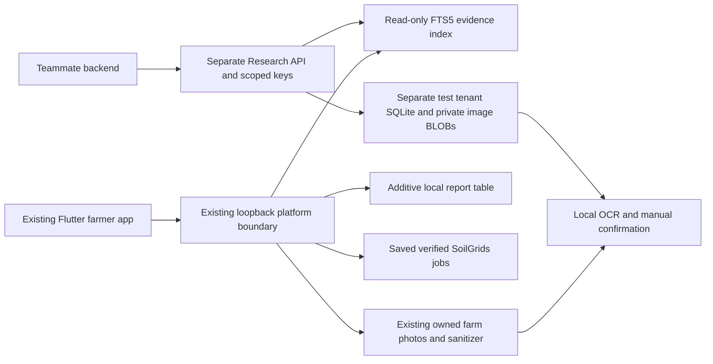

# Architecture

Two authentication boundaries share pure scientific workflows, not credentials:

`server/earthsync/research/retrieval.py` wraps the unchanged v2 loader, imports
hash-checked 7V fact/source sidecars and a small additional reference dossier.
FTS5 is a read-only in-memory index, rebuilt from shipped records at startup.
Its connection has a lock for concurrent readers; input terms are quoted, bounded
and passed as SQL parameters. No user documents, images, OCR, private notes or
arbitrary URLs enter the reference index. No vector database or paid model.

Every response retains immutable claim IDs, locators, original units, scientific
scope and source metadata. Explicit scope filters require case-insensitive exact
documented matches; unknown/global metadata is never a requested local match.
Without filters, references retain their original scope and are not presented as
locally applicable. General methods without crop identity are not assigned to a crop.

The optional explanation contract accepts retrieved claim IDs only. It returns
the original claim objects; it cannot introduce generated recommendations or
alter eligibility. A future free-prose adapter needs a separately reviewed
claim-entailment validator. No Groq chatbot is implemented.

`soil.py` keeps appearance output and report transcriptions in different schemas.
The appearance adapter accepts only allowlisted visible features and rejects
extra chemical/advisory/confidence fields. Default output is unavailable.
Tesseract runs locally with fixed arguments, sanitized PNG input and a timeout.

`storage.py` owns the separate research database, credentials, exact key/farm
grants, per-key rate counters, private PNG BLOBs, reports and minimized audit rows.
The Research API never opens the farmer application's SQLite database. The local
adapter reuses the existing farm ownership and photo paths; migration 040 adds
one report table/index with photo/farm foreign keys. Old migration bytes are unchanged.

Research operations are synchronous and bounded. There is no pretend job service;
`/jobs/{id}` was a proposed endpoint, and is intentionally not implemented.
The documented test deployment uses one worker. Public deployment and production
account management require separate review.
