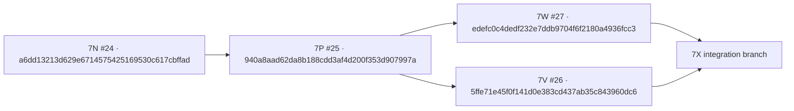

# EarthSync 7X final Web candidate

Draft PR: https://github.com/SkyRR23/EarthSync/pull/28.
Branch: `integration/earthsync-final-release-v1`. GLOBAL-FIRST, ENGLISH-FIRST.
The final full head and exact-head CI conclusions are recorded in the PR. Generate
the machine-readable final audit with `scripts/audit_7x_ci.py` outside the immutable
checkout; the PR retains exact-head workflow links and the final audit result.
Do not merge or publish either private service without separate authorization.

## Dependency graph

The branch starts exactly at 7W, then merges the complete pinned 7V once.
7N/7P already occur in 7W ancestry. No duplicate 7P import, replacement of the
7W `rule_review.json`, or rewrite of #24–#27/main occurs. The complete 7V package
remains an offline review artifact; the runtime keeps its bounded derivative.
`scripts/verify_7x_integrity.py` checks all source-package hashes and every field
of all 60 derivative records against the full package, with zero executable rules.

## Integration repairs

- v2 generated JSON/JSONL and complete 7V manifest inputs disable Git text
  conversion. Captured v2 originals retain their existing byte-preservation rule.
  Windows CI then exposed the same issue in the separately pinned v1 catalog;
  its bytes are now preserved too. Original catalog, scientific records and
  manifest hashes are unchanged. The clean `core.autocrlf=true` checkout receipt
  includes v1, all 49 v2 manifest entries and all 11 7V entries.
  All 35 original 7V input pins are checked too. Narrow root attributes preserve
  its exact upstream Python/Rust sources and scientific handoffs; a full package
  check runs in the Windows/Linux backend matrix without changing any pin.
- Docker's file-specific ignore policy admits the v2 integrity closure and its
  single runtime lookup module, plus the existing versioned review sidecar.
  It excludes tests, capture/build tooling, source metadata, private databases,
  keys, environment files and Python caches. Container smoke exercises v2 lookup,
  blocked review, actual Rust readiness/assessment and saved SQLite decisions.
- 7Q resolves Flutter with `shutil.which`, including Windows `flutter.bat`.
  It first completes SDK bootstrap with a normal version invocation, then strictly
  parses the machine response and enforces 3.44.0. No shell execution or version
  fallback is introduced. A Windows CI job builds both private runtimes through
  the ACL wrapper and starts them on loopback.
- The farm panel adds catalog-name shortcuts and Flutter date pickers. A saved
  comparison view lets farmers inspect two independently saved alternatives,
  exact dates, Rust findings, source scope and missing requirements. It computes
  no new scientific quantity and chooses no preferred crop.

See [verification](VERIFICATION.md), [reproduction/startup](RUNBOOK.md),
[input/product audit and roadmap](PRODUCT_AUDIT.md), and the short demonstration
in the runbook. The original [7W science contract](../7w/SCIENCE.md),
[7V applicability review](../7v/SCIENTIFIC_REVIEW.md), and
[7N security/storage contracts](../7n/DATABASE.md) remain authoritative.

## Scientific release boundary

Real NASA POWER historical inputs retain their original sources, response hashes,
requested/returned geometry, LST dates and missingness. The existing hash-pinned
Rust executable computes FAO-56 reference ET0 and rainfall. Neither ET0 nor rain
is a field irrigation requirement. MERRA-2 meteorology and SYN1deg radiation have
different native spatial support; these are regional inputs, not field measurements.

All 60 scientific candidates remain blocked. Crop profiles remain reference-only,
with empty rules, false candidate flags and no rankings, suitability percentages,
soil inventions, yield/profit forecasts or automatic rule promotion. The FAO-56
development/late Kc method is linear, with constant initial/mid stages. 7V's
358.50 mm versus 381.00 mm comparison is synthetic arithmetic, not accepted crop
ETc. No new native wire version or crop curve is introduced.

Crop ETc, effective rain, soil storage, depletion and irrigation remain null when
their accepted crop/field evidence is absent. Calendar support/conflict is a
chronology finding; it does not prove rotation benefit, nitrogen credit, fallow,
crop suitability or the completeness of farmer history. Unavailable providers
remain explicit gaps. Public hosting, Android runtime, accepted soil/satellite
pixels, forecasts and independently accepted crop curves remain outside this release.
