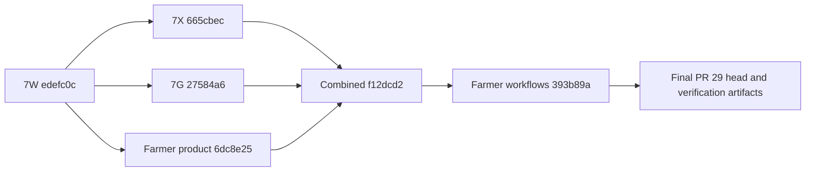

# Provenance, rights and private data

The combined candidate preserves these exact completed sources:

| Source | Exact SHA |
|---|---|
| 7N / PR #24 | `a6dd13213d629e6714575425169530c617cbffad` |
| 7P / PR #25 | `940a8aad62da8b188cdd3af4d200f353d907997a` |
| 7V / PR #26 | `5ffe71e45f0f141d0e383cd437ab35c843960dc6` |
| Initial 7W base / PR #27 | `edefc0c4dedf232e7ddb9704f6f2180a4936fcc3` |
| Completed 7X / PR #28 | `665cbecce3575724ded5145863a6823b44773a69` |
| Completed 7G / PR #30 | `27584a6e506ecda362be516b113b850c6ac98259` |
| Independent farmer-product implementation | `6dc8e25dfbc476876c2df7ff40ee558c0d8c07f8` |
| Published combined source and precision fix | `f12dcd2971e955fd2ca540e6a20c3aaf0f3124d9` |
| Completed farmer editor, tracking and assistant fixes | `393b89af913ad4a3afd078a9f164fdc4430d9f06` |

The combined `f12dcd2` commit is a merge of the completed 7X, 7G and independent
farmer-product source heads. Later commits retain that ancestry. No incomplete parallel changes were copied. Original local commits are
also preserved in archive branches. The original main rollback reference is
`1ea3df7b09637cf8162f834411d830aa8621590c`.

7N/7P/7V/7W scientific ancestry and immutable review files remain in the graph.
The v1 catalog SHA-256 remains
`2926584bce3693dff7433afe9c05c535a6d5d1e609fb502d4e2f6017f398fb0e`;
v2 catalog SHA-256 remains
`9c61fc394bd73f990fa12cba21d77a3e21028c233b956e1ce31f664178ad241b`.
The v2 integrity receipt contains 708 crop identities, 75 profiles, 937 claims,
40 sources and 8 reference rotations. Sixty rule candidates remain blocked.

NASA POWER readings preserve request periods, original inputs, missingness,
hashes and regional modeled support. Rust calculates FAO-56 reference-grass ET0;
it does not calculate a validated crop irrigation prescription. The browser's
short July test crop sequences are synthetic chronology tests, not approved
crop durations or real farmer ground truth.

SoilGrids uses the accepted WebDAV manifest and bounded native raster cells:
0–5 cm modeled mean pH, nominal 250 m grid, original scale/units/nodata retained.
No field mean, laboratory status, acquisition date or uncertainty interval is
invented. NOAA GFS uses bounded GRIB temperature subsets, 0.25° native support,
verified model initialization and valid times, Kelvin-to-Celsius conversion and
original source hashes. Publication time is unavailable. Cached snapshots retain
original source times. NDVI imagery remains unavailable; no colored substitute
or true-color image is called a vegetation index.

See [7G science and rights](../integration/7g/SCIENCE.md) for NASA, ISRIC,
NOAA, OSM/Esri/GIBS source-specific attribution and provider limitations. OpenFarm
was inspected as a BSD-3-Clause reference; the retained audit identifies reuse
and attribution obligations. See [7G audit](../integration/7g/AUDIT.md).
Existing repository license/third-party notices and crop-source citations remain
in place; no new LLM, paid AI service or model training is introduced.

Private farm APIs remain a loopback-only single-user local service, protected by
Host/Origin/owner checks, strict source allowlists, quotas and executable hashes.
This is not a public multi-user authentication system. Farm-owned photos and the
original workspace's token-authorized photos remain separate stores. Uploads use
the existing sanitization pipeline; observations attach owned photo IDs.

Opt-in local device snapshots can contain private reports and location. Settings
and the season screen disclose this and allow deletion. Cache keys bind the API
origin and exact confirmed farm revision. Forbidden/not-found responses do not
fall back to private cache. The public service worker caches only an explicit
hash-versioned static allowlist; never private API responses, tokens or images.
No databases or authorization storage-state files belong in release artifacts.

Final UI/interpretation and verification files follow `393b89a`; the exact final
source SHA is the current PR #29 head, with check results recorded on that PR.
Do not use an earlier green head to certify a later change. Runtime artifact and
scientific-package hashes are retained in `evidence/artifact-hashes.json` and
`evidence/source-integrity.log`.
