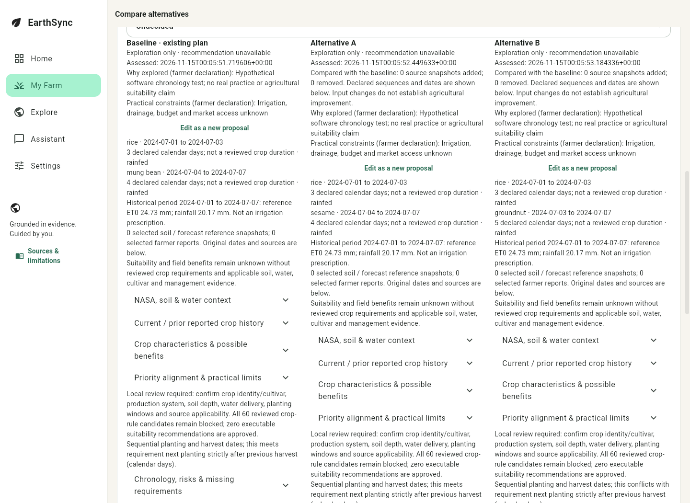

# EarthSync global validation

Tested integrated candidate: `660b479c3ffb714cd1d489e1241c026ceae6ed67` ([PR #29](https://github.com/SkyRR23/EarthSync/pull/29)). Production source and main remain unchanged.

Read the [global accuracy report](GLOBAL_ACCURACY_REPORT.md), [NASA-objective coverage](NASA_OBJECTIVE_COVERAGE.md), [limitations](BUGS_AND_LIMITATIONS.md) and [reproduction guide](REPRODUCTION_GUIDE.md). Results distinguish numerical verification, real-source consistency, synthetic workflow tests and independent field validation that remains unavailable. No overall accuracy score or crop recommendation is approved.

Screenshot: actual Chromium/Flutter rendering; **synthetic declared plans/history** and **cached real July 2024 NASA evidence**. Crop dates test chronology, not reviewed maturity. Myanmar source profiles retain regional scope. This view has no selected soil/forecast snapshot; their separate source-consistency results are not misrepresented as attached evidence. All three cards show recommendation unavailable and local-review requirements.
